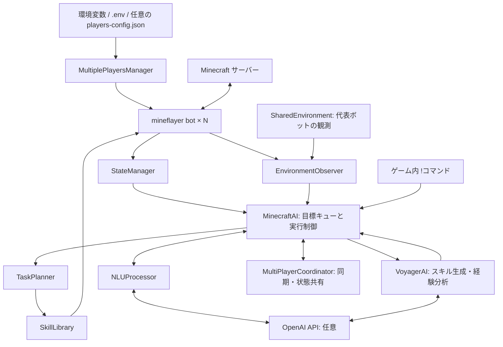

# MineCortex の現状と仕組み

## 1. 調査範囲と結論

- 調査日: 2026-11-15。調査開始時の HEAD: `bb72dde`。
- `README.md`、`README_ja.md`、`CLAUDE.md`、`package.json`、`package-lock.json`、`.env.example`、`config/`、`src/` 全体、起動スクリプト、Lint・Jest 設定を確認した。`src/*.bak` は現行ファイルとの差分を確認した。認証・インストールガイドも補足として参照した。
- 以下は現在のコードに基づく説明である。Minecraft サーバー接続や OpenAI API を利用した実動作・性能測定は行っていない。

MineCortex は、**1つの Node.js プロセスから複数の Minecraft ボットを接続し、採集・採掘・道具作成・探索を自律実行するソフトウェア**である。mineflayer がゲームを操作し、ルールベースの目標・計画・スキルが基本行動を担う。OpenAI を設定すると、日本語コマンドの解釈、未登録スキルの JavaScript 生成、失敗分析、学習課題の生成を追加する。

Voyager に着想を得た独自実装であり、別途 Voyager サーバーやモデル学習プロセスを起動する構成ではない。Web UI、HTTP サーバー、永続 DB は実装されていない。基本構成は揃っているが、スキルの実行エラーや各機能の接続不足があり、README の機能紹介をそのまま動作保証と解釈することはできない。

## 2. 起動方法とエントリーポイント

### 2.1 実行環境

`package.json` と README は Node.js `>=16.13.0` としている。しかし、**現在のロックファイル内の mineflayer 4.30.0 は Node.js `>=22` を要求する**。Jest 30.0.4 の要求も Node.js 16 を含まないため、ロックファイル通りの構成では Node.js 16 を前提にできない。

Minecraft は README 上では Java Edition 1.21 を対象とする。起動コードは `version` を指定せず `mineflayer.createBot(config)` に渡すため、実際の接続可否はサーバーとインストールされた依存の組み合わせで確認する必要がある。Minecraft サーバー本体はリポジトリに含まれず、自動起動もしない。

### 2.2 起動コマンド

以下は依存・接続設定を準備した環境での手順である。今回の調査では依存インストールや `.env` 作成は行っていない。

```bash
# リポジトリ直下で依存をインストール
npm ci

# 環境変数または .env で接続先を指定して起動
MINECRAFT_HOST=localhost MINECRAFT_PORT=25565 \
MINECRAFT_AUTH=offline MULTIPLE_PLAYERS_COUNT=3 npm start

# JSON 設定の有効プレイヤー5体を使用する場合
MULTIPLE_PLAYERS_COUNT=5 npm start -- --config
```

`.env` を利用する場合は `.env.example` を元に設定できる。ただしテンプレートの `OPENAI_API_KEY` はプレースホルダーであり、OpenAI を使わない場合は削除または空にする。非空文字列があると OpenAI 利用経路が有効になる。環境変数方式で固定名を使うには `PLAYER1_USERNAME` などを指定する。

- `npm start` / `package.json.main` の実体はいずれも [examples/multiple-players.js](examples/multiple-players.js)。CommonJS の JavaScript を直接実行する。
- **コード上の既定起動数は3体、上限は10体**。README・CLAUDE.md の「既定5体」とは異なる。人数の厳密な入力検証はなく、正の整数を設定する必要がある。
- `--config` がない場合、`config/players-config.json` は使用しない。
- `--config` 時は `enabled: true` のプレイヤーを設定人数・上限10体まで順に起動する。JSON の有効人数全員を同期開始の期待人数にするため、起動人数をそれより小さくすると同期完了まで進まず、最大2分の待機後に各 AI が開始する。
- `Ctrl+C`、`SIGTERM` で各 AI・ボット・共有コンポーネントを停止し、プロセスを終了する。

### 2.3 起動から行動開始まで

1. `dotenv.config()` で `.env` を読む。
2. `MultiplePlayersManager` がボット管理用 Map を作る。人数が2以上なら共有環境・共有パスキャッシュを、API キーがあれば API キューを作る。
3. 各プレイヤーの設定を解決し、`mineflayer.createBot()` と pathfinder プラグインのロード、`MinecraftAI` の生成を行う。最初のボット生成時に共有の `MultiPlayerCoordinator` も作る。
4. `login` でボット名を確定し、Coordinator と共有観測へ登録する。
5. `spawn` で `ai.onSpawn()` と `ai.initialize()` を呼ぶ。全員の準備完了または2分の待機を経て、17個の既定スキルを登録する。
6. 初期目標として、木材収集 → 石採取 → 基本道具作成 → 食料確保 → 探索を設定し、各ボットの非同期 AI ループを開始する。

ボットは別プロセスではなく同一プロセス内のオブジェクトであり、共有状態もメモリ上の Map・Set・配列である。起動成功ログはオブジェクト生成の成功を示し、ゲームへの接続完了を保証するものではない。

## 3. 全体アーキテクチャ

### 3.1 主要モジュール

| ファイル | 役割と接続状況 |
| --- | --- |
| `examples/multiple-players.js` | 設定解決、ボット生成、イベント接続、30秒ごとの接続状況表示、再接続、終了処理。 |
| `src/MinecraftAI.js` | 各ボットの統括。目標キュー、観測・状態同期、危険対応、計画・スキル実行、結果記録、チャット受付を管理する。 |
| `src/TaskPlanner.js` | 目標を `{type, params, priority, timeout, prerequisites}` に変換する。未知の目標はキーワードと在庫から既存行動へ変換する。 |
| `src/SkillLibrary.js` | スキルの登録・検索と実操作。レシピ検索、別名解決、木材代替、クラフト等も実装する。 |
| `src/InventoryUtils.js` | 在庫集計、木材・石・食料・道具判定、素材計算、道具の更新可否などの共通処理。 |
| `src/VoyagerAI.js` | スキル生成、経験記録、失敗分析、カリキュラム生成。OpenAI 未設定時の限定的な代替処理も持つ。 |
| `src/NLUProcessor.js` | OpenAI の tool calling で日本語を intent / entities に変換する。実行自体は MinecraftAI が行う。 |
| `src/StateManager.js` | 各ボットの位置・在庫・タスク・既知スキル・成績を保持し、購読者へ変更通知する。状態履歴・妥当性検査・ロールバックも持つ。 |
| `src/EnvironmentObserver.js` | 周辺ブロック・エンティティ、危険、資源、水中状態、地形等を観測・要約する。全体更新処理の呼び出し不足は後述。 |
| `src/SharedEnvironment.js` | 2秒ごとに代表ボットの周辺データ・時刻・天候を取得し、全 Observer にコピーする。 |
| `src/MultiPlayerCoordinator.js` | 全員準備完了の同期、プレイヤー状態、資源の利用権、競合調整、適任者選定、チャット経由の通知を扱う。 |
| `src/PathfindingCache.js` | 座標をキーとする経路キャッシュ、近傍検索、期限切れ削除、統計。通常経路での再利用は未接続。 |
| `src/OpenAIRequestQueue.js` | 優先度、同時実行数、RPM 制限、再試行を持つ API キュー。通常の LLM 呼び出しはこのキューを通らない。 |
| `src/PerformanceMonitor.js` | CPU・RSS・heap・イベントループ遅延・処理時間を記録する。各ボットに作られるが CPU・メモリ値はプロセス全体の値。 |
| `src/ControlPrimitives.js` | 採掘・作成・設置・探索・移動の操作ラッパー。現在のメイン起動経路からは利用されない。 |
| `src/RecipeDiagnostics.js` | アイテム・レシピ構造の診断。メイン AI からは利用されず、`node src/RecipeDiagnostics.js` で診断処理を実行できる。 |
| `src/utils/MovementUtils.js` | ブロック・座標・エンティティへの接近とタイムアウトを統一し、スキルから利用される。 |
| `src/utils/Logger.js` | 標準出力・標準エラーへの接頭辞付きログ。デバッグ出力は `DEBUG_MODE=true` の場合のみ。 |
| `src/utils/ValidationUtils.js` | bot、在庫、目標、タスク等の入力検証。TaskPlanner などで利用する。 |
| `src/utils/ErrorHandler.js` | 例外を失敗結果へ変換するラッパー。現在の src / examples に利用元はない。 |

`src/` 内の6つの `.bak` はバックアップであり、起動コードから読み込まれない。現行との差分は主として Logger への置換である。

### 3.2 データの流れ



API キューやパスキャッシュは生成されるものの、現在の実行経路で主要処理を仲介していないため、図では有効な中継経路として示していない。

### 3.3 AI ループとタスク実行

通常の1巡では、状態同期 → 観測位置更新 → Coordinator への位置・タスク等の報告 → 脅威対応 → タスク完了・期限確認 → クラフト機会確認 → 次の目標の計画 → スキル実行 → 成否・経験の記録を行う。

目標は配列の先頭から `shift()` で取り出し、追加の緊急目標やユーザー指示は主に `unshift()` で先頭へ入れる。`priority` は計画に保持されるが、目標全体を数値順にソートするスケジューラーではない。計画の一部は `goal.priority || 既定値` を使うため、優先度0も既定値へ置き換わる。

スキルは `execute(bot, params)` で mineflayer を操作し、原則 `{success, ...}` を返す。実行時間制限はタスクごとに計算し、15秒～180秒に制限する。失敗回数に応じて回復目標や探索を追加する。ループ待機は通常200msを基準に状況で調整するが、スキルと API 呼び出しは await するため、ループが常にこの間隔で進むわけではない。

既定スキルは次の17種である。

- 移動・探索: `move_to`、`follow`、`explore`、`smart_jump`、`escape_water`、`navigate_terrain`
- 操作・採集: `mine_block`、`place_block`、`attack_entity`、`gather_wood`、`find_food`
- 作成・設置: `craft_tools`、`craft_workbench`、`place_workbench`、`craft_with_workbench`、`craft_furnace`、`place_blocks`

例えば `find_stone` は Planner が `mine_block` に、`craft_basic_tools` は `craft_tools` に変換する。計画には素材や道具の `prerequisites` を付けるが、MinecraftAI はこれを順に実行する処理を持たない。一部スキル内の素材確保・補助クラフトで対応する構成である。

### 3.4 ボット間の協調

Coordinator はユーザー名から explorer / miner / builder 等の役割を推定する。資源を種類と8ブロック単位の座標で管理し、5分の利用権期限、距離・役割・体力・食料・協力スコアによる競合判定を用意している。

実際に主経路で行うのは、登録、開始待ち、状態報告、状態表示などである。資源予約を伴う `executeResourceAwareTask()` は通常の実行ループから呼ばれず、採集全体が自動で排他制御されるわけではない。`coordinateTask()` も適任者の選定・通知までで、相手 AI の目標キューへタスクを投入する処理はない。

プレイヤーごとに異なる接続先を指定することはできるが、Coordinator・共有環境・キャッシュにはサーバーやディメンションを分離するキーがない。複数ワールドをまたぐ正しい協調は確認できない。

## 4. チャット操作と OpenAI・学習

### 4.1 ゲーム内コマンド

`onChat()` は **`!` から始まるメッセージのみ**処理する。各ボットは自分以外の同じチャットを受信するため、同一サーバー内の複数ボットが同じ命令に反応しうる。

| コマンド | 現在の処理 |
| --- | --- |
| `!status` | bot 本体の体力・食料・位置を表示。 |
| `!goto x y z` | 座標移動の目標を先頭に追加。 |
| `!follow` | 発言者を追従対象にする。README の `!follow <player>` の引数は静的コマンド実装では使わない。 |
| `!stop` | `currentTask` を null にする。目標キュー全削除・実行中 Promise の取消・pathfinder 停止は行わない。 |
| `!learn` / `!curriculum` | 学習統計表示 / 新しい課題を目標キューへ追加。 |
| `!coord` / `!claim x y z type` / `!release` | 協調状態表示 / 資源利用要求 / 自分の利用権解除。 |
| `!state` / `!perf` | StateManager の状態 / タスク・スキル成績を表示。`!perf` は CPU 等を表示するコマンドではない。 |
| その他の `!指示文` | 例: `!石を10個掘って`。API キーがあれば NLU で解釈する。 |

### 4.2 OpenAI 呼び出しとメモリ

- NLU は移動・探索・採掘・木材収集・作成・追従・在庫確認・状態確認・停止の9種を tool calling で解釈する。
- VoyagerAI は未登録スキルのコードを生成し、`new Function` で実行可能にする。生成コードはボットと同じ Node.js プロセスで実行され、専用の隔離実行環境はない。
- 実行結果を最大100件の経験として保持し、過去の失敗から改善提案を生成・最大20件保存する。カリキュラムは既存スキル・目標・最近の経験を材料に作る。
- API キーがなければ NLU は無効になる。既定スキルは利用できる設計だが、Voyager の代替生成は `explore_area`、`collect_resource`、`build_structure` に限定され、それ以外は `Generic skill not implemented` を返す。
- 生成スキルを SkillLibrary に再登録する経路、`skillCache` を使う経路、保存した改善提案を次のスキル生成へ組み込む経路は未接続。現状の「学習」は経験・提案・統計のメモリ保持が中心で、モデルの再学習ではない。
- 学習内容・状態・経路はプロセス終了で失われる。学習データ用 DB や保存ファイルはない。設定 JSON の読み込みは別途行う。
- OpenAI に渡す情報には指示文、位置、体力・食料、在庫要約、周辺情報、タスクと失敗履歴が含まれる。Voyager / NLU はそれぞれ SDK を直接呼び出す。

## 5. 外部依存と設定

### 5.1 npm 依存

| パッケージ | package.json の指定 | ロックファイル内 | 主な用途 |
| --- | --- | --- | --- |
| `mineflayer` | `^4.29.0` | `4.30.0` | Minecraft 接続・ゲーム操作。 |
| `mineflayer-pathfinder` | `^2.4.0` | `2.4.5` | 経路探索、移動目標。 |
| `minecraft-data` | `^3.90.0` | `3.93.0` | 接続版のアイテム・ブロック・レシピ情報。 |
| `vec3` | `^0.1.8` | package-lock.json 参照 | 座標計算。 |
| `openai` | `^4.0.0` | `4.104.0` | 任意の LLM 利用。API 未使用でもモジュール読込のためインストールは必要。 |
| `dotenv` | `^16.0.0` | `16.6.1` | `.env` 読み込み。 |
| `cross-env` | `^7.0.3` | package-lock.json 参照 | 依存定義はあるが現在の npm scripts / src / examples では未使用。 |
| ESLint と Standard・各 plugin | `package.json` 参照 | ESLint `8.57.1` | 開発時の静的検査。 |
| `jest` | `^30.0.4` | `30.0.4` | 開発時のテスト実行。 |

外部プロセスとして Minecraft サーバーが必要で、ボットは設定された host / port へ接続する。`auth` は mineflayer にそのまま渡される。既定の `offline` はそれを受け入れるサーバーが必要で、Microsoft 認証を使う場合は対応アカウント・認証手順が別途必要となる。認証処理は依存ライブラリに委ねられ、リポジトリ独自のアカウント管理実装はない。

OpenAI を使う場合は、有効な API キー、指定モデルの利用権限、外部 API への接続が必要。ほかに必須の DB・Redis・Python サービス等はコード上見当たらない。

### 5.2 実装で参照される環境変数

| 変数 | 実装上の既定値・効果 |
| --- | --- |
| `MULTIPLE_PLAYERS_COUNT` | `3`。上限10体。共有環境の生成判定にも使用。 |
| `MINECRAFT_HOST` / `MINECRAFT_PORT` | `localhost` / `25565`。環境変数方式の共通接続先。 |
| `MINECRAFT_AUTH` | `offline`。共通認証方式。 |
| `PLAYER<n>_HOST` / `_PORT` / `_AUTH` | プレイヤー別指定。共通値より優先する。 |
| `PLAYER<n>_USERNAME` | 指定がなければ日本語の形容詞・名詞と数字によるランダム名。`MINECRAFT_USERNAME` へのフォールバックはない。 |
| `PLAYER<n>_PERSONALITY` | `generalist`。bot 作成設定に渡すが、現在の AI の目標選択へ反映する経路はない。 |
| `PLAYER<n>_SPAWN_DELAY` | `n × 2000` ms。該当プレイヤー起動後、次のプレイヤーまでの待機に使う。 |
| `SPAWN_DELAY` | `2000` ms。個別の非ゼロ待機値がない場合に使う。0は `||` により既定値になる。 |
| `AUTO_RESPAWN` | 文字列 `true` の場合、切断後に再接続を予約する。死亡イベント時の bot の自動リスポーン可否を切り替える実装ではない。 |
| `OPENAI_API_KEY` | 未設定なら NLU 無効・Voyager は代替処理。非空なら SDK と API キューを初期化する。 |
| `OPENAI_SKILL_MODEL` | `gpt-4o`。スキルコード生成。 |
| `OPENAI_ANALYSIS_MODEL` | `gpt-4o-mini`。失敗分析。 |
| `OPENAI_CURRICULUM_MODEL` | `gpt-4o-mini`。課題生成。 |
| `OPENAI_MODEL` | `gpt-4o-mini`。現在は NLU 用。Voyager の3用途の共通フォールバックにはならない。 |
| `DEBUG_MODE` | 文字列 `true` の場合に詳細ログ。 |
| `PERFORMANCE_MONITORING` | `false` 以外なら監視有効。 |
| `PERF_LOG_INTERVAL` | `10000` ms。性能監視レポート間隔。 |
| `EVENT_LOOP_THRESHOLD` | MinecraftAI から渡す既定値は `50` ms。Monitor 単体の既定75ms、テンプレートの75msとは異なる。 |

`.env.example` のうち、`MINECRAFT_USERNAME`、`CUSTOM_USERNAME`、`RESPONSE_DELAY`、`PATHFINDING_*`、`LEARNING_ENABLED`、`SKILL_CACHE_SIZE`、`LEARNING_HISTORY_SIZE`、`MAX_MEMORY_USAGE`、`TASK_TIMEOUT`、`TEST_MODE`、`MOCK_OPENAI`、`VERBOSE_LOGGING`、`EXPERIMENTAL_FEATURES`、`SECURE_CONNECTION`、`VALIDATE_SESSION`、`RATE_LIMIT_*` は現在の src / examples で参照されない。コメントアウトされた `LOW_SPEC_*`、`MAX_BOTS`、GC・メンテナンス間隔等の調整案も同様である。記載があっても設定として機能するとは限らない。

### 5.3 設定ファイル

**`config/players-config.json`**

- `--config` 時だけ使う。10人分の定義があり、1～5番が有効、6～10番は無効。
- 実際に読む項目は `players` の `id`、`enabled`、`host`、`port`、`username`、`auth`、`aiPersonality`、`spawnDelay`。
- プレイヤーが見つかればその定義を採用し、個々の host 等を環境変数とマージする処理はない。読込失敗・該当プレイヤーなしでは環境変数方式へ戻る。
- `global` の再接続・デバッグ設定と、`personalities` の目標・行動パラメーターは現在の起動経路で利用されない。役割の推定は主にユーザー名に依存する。

**`config/item-alias.json`**

- アイテム別名、バージョン別別名、木材等の素材候補、生存向け重要レシピを定義する。
- SkillLibrary のレシピ検索で遅延読み込みする。別名・素材候補を使った名前解決と代替検索を支援する。設定読込に失敗した場合は空の別名・素材候補へ戻る。
- レシピ検索には5分のキャッシュがあり、通常の `recipesFor` 等に加えて minecraft-data のレシピ情報や手動の代替処理を用いる。

## 6. ビルド・Lint・テスト

ビルド・トランスパイル工程はなく、`npm run build`、開発用 watcher、ホットリロード用 script もない。コード変更を反映するにはプロセスの再起動が必要である。

```bash
npm ci                    # ロックファイルに基づく依存インストール
npm run lint              # eslint .
npm run lint:fix          # 自動修正。既存コードを書き換えるため今回未実行
npm test                  # jest
npm run test:watch        # jest --watch
npm run test:coverage     # jest --coverage
```

`.eslintrc.js` は Standard をベースにセミコロンあり等へ調整している。`jest.config.js` は Node 環境で `**/test/**/*.test.js` を探索し、`src/**/*.js` をカバレッジ対象にする。ただし、**このチェックアウトには `test/` とテストファイルがない**。`.gitignore` も `test/` を除外している。テストの実装が存在する前提では扱えない。

README は `npm start` を実動作確認として案内している。これは Minecraft へ接続して自律行動を開始する統合確認であり、独立したテストランナーではない。

### 今回の検証結果

| 確認 | 結果 |
| --- | --- |
| 作業環境 | Node.js `v24.22.1`、npm `10.9.4`。 |
| 依存確認 `npm ls --depth=0` | 全13件が `UNMET DEPENDENCY`。`node_modules/` なし。 |
| 設定・認証 | `.env` なし。プロセス環境にも OpenAI キーと Minecraft 接続先・認証方式の指定なし。秘密値は出力していない。 |
| JavaScript 構文 | src、examples、Jest・ESLint 設定の22ファイルを `node --check` で確認し、すべて成功。構文の確認でありゲーム内動作の確認ではない。 |
| JSON 解析 | package、ロックファイル、config 内 JSON は解析成功。 |
| `npm run lint` | `eslint: not found`、終了コード127。Lint 結果は未確認。 |
| `npm test -- --runInBand` | `jest: not found`、終了コード127。テスト実行結果は未確認。 |
| 外部接続なしの簡易検証 | 実ソースをメモリ上で読み、外部依存をスタブにして、スキルの logger 不足と NLU → Planner の情報欠落を再現。実ゲームの統合テストではない。 |
| Minecraft / OpenAI | 起動・接続・認証・API 呼び出し・性能測定は未実施。 |

## 7. 動作上の不足・未実装・未確認事項

### 7.1 まず解消・確認が必要な事項

- **依存が未インストール**。現状の作業環境では起動・Lint・Jest を実行できない。README とロックファイルの Node.js 要件にも差がある。
- **Minecraft 接続先・認証が未確認**。対象サーバーの起動状態、受入認証方式、接続版、ボット名、接続上限を実機で確認する必要がある。既定ランダム名には日本語を使うため、ユーザー名の制約との適合も未確認。`PLAYER<n>_USERNAME` 等で名前を明示できる。
- **OpenAI 認証・モデル利用権限が未確認**。API キーはなく、API を使った NLU・生成・分析は検証していない。モデル名はコードの既定値を記載したもので、現在の提供状況を検証したものではない。
- **既定スキルの logger が未初期化**。[Skill 基底クラス](src/SkillLibrary.js#L601) は name / description だけを設定するが、多くのスキルが `this.logger.log()` を呼ぶ。既定17スキルすべてに logger がないこと、近傍への `move_to` 実行が TypeError になることをスタブ検証で確認した。Logger を持つ SkillLibrary と個々の Skill インスタンスは別物である。
- **採掘スキル内にも未定義メソッドの呼び出しがある**。`MineBlockSkill` の `handleOutOfSightBlock()`、`getSkill()`、`simpleWoodGathering()` はそのクラスや基底クラスに定義されておらず、別クラスの機能をそのまま利用できない。logger 問題以外にも、該当分岐の動作確認・修正が必要である。

### 7.2 主経路の接続不足

- **観測の全体更新が呼ばれない**。[メインループ](src/MinecraftAI.js#L703) は `observer.updatePosition()` のみを呼び、[Observer.update()](src/EnvironmentObserver.js#L49) の呼び出し元がない。共有側も個別ボットの更新を行わないため、Observer の体力・食料・在庫要約・観測履歴が更新されず、単体起動では周辺エンティティ・ブロックも更新されない。危険判定や LLM コンテキストに影響する。
- **共有観測が全員の周辺を表さない**。代表1ボットのデータと代表基準の距離を全員へ配るため、離れたボットでは自分の近傍情報として不正確になる。
- **StateManager の体力・食料参照に不整合**。[同期処理](src/StateManager.js#L205) は `bot.entity.health / food` を読む一方、他の処理は `bot.health / food` を使う。状態表示・成績・判断への影響は実機で未確認。
- **NLU の指定内容が Planner まで保持されない**。スタブ検証では「iron_ore を2個」の目標が `mine_block: stone, amount: 5` に、「torch を4個」が既定の木製道具作成に、「birch を2個」が樹種指定なしの木材20個収集に変わった。`count / item / target` と Planner が使う `amount / tools / description` 等の受け渡しが揃っていない。
- **前提タスク・協調実行が自動実行経路に未統合**。`prerequisites` の逐次実行、資源予約付き実行、他ボットへのタスク投入は主ループに接続されていない。
- **API キュー制限が通常の API 呼び出しに効かない**。Manager は同時2件・毎分30件のキューを生成するが、`enqueueRequest()` の利用元がなく、Voyager / NLU は直接 SDK を呼ぶ。
- **経路キャッシュの実再利用が未実装**。`getPath()` の利用元がなく、[保存する経路](src/SkillLibrary.js#L717) も `path: []` の TODO のまま。最適化の効果を主経路で確認できない。
- **学習の再利用が限定的**。生成スキルの再登録と、保存した改善提案の次回生成への反映が未接続。永続化もない。

### 7.3 行動・運用上の制約

- **避難所建設は代替行動**。通常の `build_shelter` 目標は [planShelterBuilding()](src/TaskPlanner.js#L222) が探索へ変換する。ブロック設置スキルは存在するが、避難所の自動設計・建築まで完成しているわけではない。
- **計画が未登録スキルを返す場合がある**。`craft_stone_tools` や汎用建築計画の `build_shelter` は既定17スキルに含まれず、実行時の生成処理へ進む。OpenAI 未設定時はこれらの代替実装もない。
- **停止・期限切れが実操作を確実に取り消さない**。`!stop` はタスク参照を消すだけで、タイムアウトも待機 Promise を終了させる仕組みである。実行中スキルの操作と次の操作が重ならないかは未確認。
- **再接続・終了処理に検証余地がある**。再接続時は `--config` の利用状態を引き継がず、プレイヤー情報も作り直す。AI の終了処理が bot の全イベントリスナーを削除するため、Manager の切断・再接続通知との整合も要確認。初期化前の終了は早期 return する。
- **長期監視のメモリ保持に制限がない箇所がある**。PerformanceMonitor の計測配列は自動間引きされず、API キューの interval も shutdown で停止されない。プロセスを終了しない利用形態や長時間運転は未確認。
- **ドキュメントに旧構成の記述が残る**。package の版は1.5.0、CLAUDE.md は1.6.4、履歴にはそれ以降の版がある。`.env.example` の `multi-players` / `advanced-multi` scripts、ガイド中の `index.js`、README のホットリロード等は現在の実行構成と一致しない。
- **実機での成功率・性能・1.21互換性は未確認**。README の「5体テスト済み」や CPU・メモリ値は既存の記述であり、今回再検証した測定結果ではない。

## 8. 参照先

- 概要: [README.md](README.md)、[README_ja.md](README_ja.md)、[CLAUDE.md](CLAUDE.md)
- 起動・依存: [package.json](package.json)、[package-lock.json](package-lock.json)、[起動スクリプト](examples/multiple-players.js)
- 設定: [.env.example](.env.example)、[プレイヤー設定](config/players-config.json)、[アイテム別名](config/item-alias.json)
- 検査設定: [.eslintrc.js](.eslintrc.js)、[jest.config.js](jest.config.js)

本調査の変更は、この `SUMMARY.md` の追加のみである。
